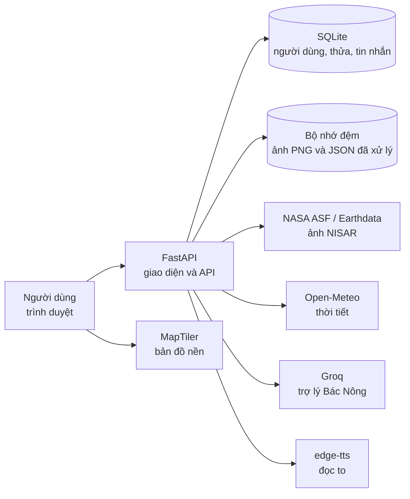
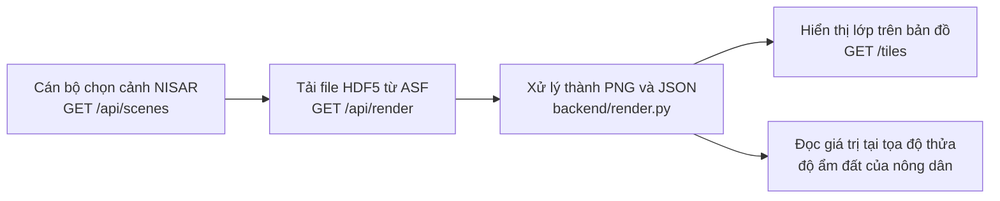
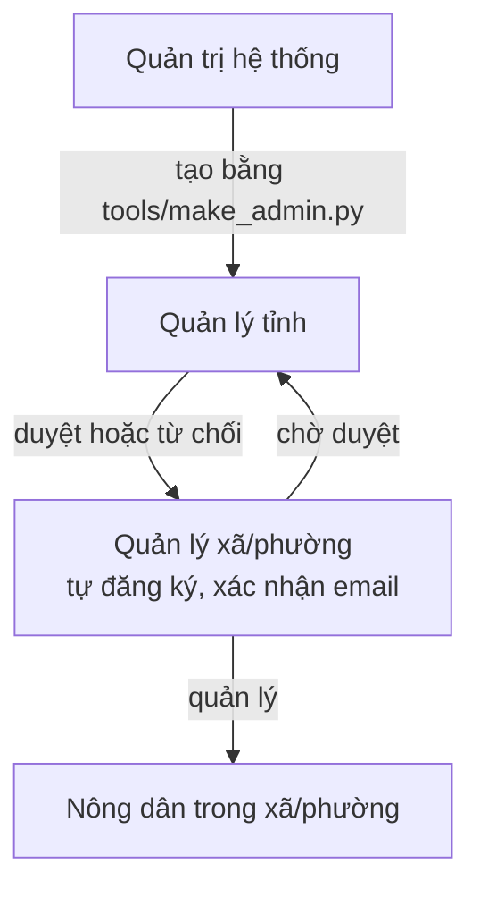
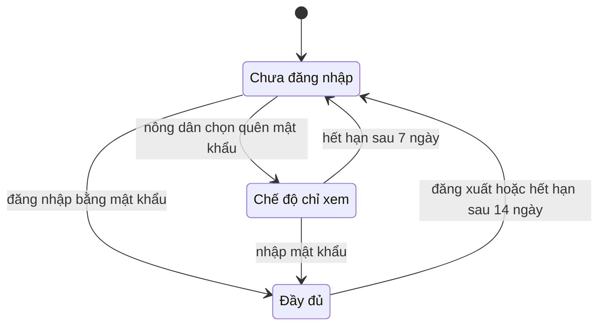

# EcoPulse

Độ ẩm đất từ vệ tinh cho nông dân Tây Nguyên.

EcoPulse biến dữ liệu radar của vệ tinh NISAR thành thông tin dễ dùng cho từng thửa đất: độ ẩm đất, thời tiết, khuyến nghị canh tác. Cán bộ xã, phường và tỉnh dùng cùng hệ thống để hỗ trợ nông dân, gửi thông báo và đăng bài kiến thức.

## Chức năng

| Đối tượng | Chức năng chính |
|---|---|
| Nông dân | Khai báo thửa (cây trồng, vị trí, ảnh); xem độ ẩm đất, nhiệt độ, lượng mưa 7 ngày và khuyến nghị canh tác; nhận thông báo; nhắn tin với cán bộ; đọc bài kiến thức; hỏi trợ lý Bác Nông |
| Quản lý xã/phường | Quản lý nông dân trong khu vực; gửi thông báo hàng loạt; trả lời tin nhắn; viết bài kiến thức; xử lý cảnh vệ tinh mới |
| Quản lý tỉnh | Duyệt quản lý xã/phường; duyệt bài kiến thức; khóa hoặc mở khóa tài khoản; xem nhật ký hoạt động |

Bản đồ NISAR (`/map`) có ba lớp: độ ẩm đất, thảm thực vật (RVI) và cường độ HV, kèm ranh giới tỉnh và mạng sông suối.

## Kiến trúc



## Từ ảnh vệ tinh đến từng thửa



Chỉ cán bộ được bắt đầu xử lý cảnh mới (tải file lớn, tốn tài nguyên). Nông dân xem các cảnh đã xử lý.

## Vai trò và phê duyệt



Tài khoản quản lý xã/phường chưa đăng nhập được cho đến khi quản lý tỉnh duyệt.

## Đăng nhập và phiên



| Chức năng | Đầy đủ | Chế độ chỉ xem |
|---|---|---|
| Xem thửa của tôi (danh sách, chi tiết, lịch sử, ảnh) | Có | Có |
| Thêm, sửa, xóa thửa và ảnh | Có | Không |
| Thông báo, tin nhắn, kiến thức | Có | Không |
| Bản đồ, trợ lý Bác Nông, đọc to | Có | Không |

Khi chủ tài khoản đăng nhập bằng mật khẩu, mọi phiên chỉ xem của tài khoản đó bị thu hồi.

## Cấu trúc thư mục

```text
backend/
  main.py          Khởi tạo ứng dụng, tiêu đề bảo mật, API bản đồ
  hydro.py         Tài khoản, phiên, thửa, tin nhắn, tin tức, quản trị
  render.py        Tải và xử lý ảnh NISAR
  assistant.py     Trợ lý Bác Nông (Groq) và soạn bài bằng AI
  weather.py       Thời tiết từ Open-Meteo
  boundaries.py    Ranh giới tỉnh và xã/phường
  provinces.py     Danh sách tỉnh
  rivers.py        Sông suối
static/            Giao diện: landing.html, app.html, index.html (bản đồ)
tools/             make_admin.py, export_safe_db.py, merge_provinces_2025.py
scripts/           build_rivers.py
tests/             Kiểm thử bảo mật
```

## Chạy trên máy

Yêu cầu: Python 3.12 trở lên.

```powershell
git clone https://github.com/phuc123-hn/EcoPluse.git
cd EcoPluse
python -m venv .venv
.venv\Scripts\activate
pip install -r requirements.txt
copy .env.example .env
python -m uvicorn backend.main:app --reload
```

Trên macOS hoặc Linux dùng `source .venv/bin/activate` và `cp .env.example .env`.

Mở `http://localhost:8000`. Tạo tài khoản quản lý tỉnh đầu tiên (mật khẩu được hỏi khi chạy):

```powershell
python tools/make_admin.py email@example.com "Tên hiển thị" "Tên tỉnh"
```

Nếu `.env` có `HN_ADMIN_EMAIL` và `HN_ADMIN_PASSWORD` thì tài khoản này cũng được tạo tự động, nhưng chỉ khi hệ thống chưa có quản lý tỉnh nào.

## Biến môi trường

Sao chép `.env.example` thành `.env` rồi điền giá trị. Không đưa `.env` lên Git.

| Biến | Bắt buộc | Mô tả |
|---|---|---|
| `GROQ_API_KEY` | Có | Khóa Groq cho trợ lý. `GROQ_MODEL` chọn mô hình |
| `EARTHDATA_TOKEN` | Có | Token NASA Earthdata để tải ảnh NISAR |
| `NEXT_PUBLIC_MAPTILER_KEY` | Có | Khóa bản đồ nền. Nên giới hạn theo tên miền trong MapTiler |
| `HN_ADMIN_EMAIL`, `HN_ADMIN_PASSWORD` | Không | Tạo quản lý tỉnh đầu tiên khi chưa có ai |
| `HN_DB`, `CACHE_DIR` | Khi chạy thật | Đường dẫn DB và bộ nhớ đệm, đặt trên ổ đĩa bền (ví dụ `/data`) |
| `PRODUCTION`, `COOKIE_SECURE` | Khi chạy thật | Bật cookie Secure và tắt trang `/docs` |
| `TRUSTED_PROXIES` | Khi chạy thật | Số proxy đứng trước ứng dụng. Railway: `1`. Máy cá nhân: `0` |
| `SMTP_HOST`, `SMTP_PORT`, `SMTP_USER`, `SMTP_PASS`, `SMTP_FROM` | Không | Gửi email mã xác nhận. Chưa cấu hình thì mã in ra cửa sổ chạy server |
| `LIMITED_DAYS`, `MAX_RENDER_JOBS`, `TTS_GOOGLE_FALLBACK`, `RENDER_DEBUG` | Không | Tinh chỉnh, xem chú thích trong `.env.example` |

## Triển khai trên Railway

1. Tạo dự án từ repository GitHub này. Lệnh khởi động nằm sẵn trong `railway.json`.
2. Thêm một Volume gắn tại `/data`. Không có Volume thì mỗi lần triển khai sẽ mất dữ liệu.
3. Nhập các biến ở bảng trên vào mục Variables, với `HN_DB=/data/hydronisar.db` và `CACHE_DIR=/data/cache`.
4. Tạo domain công khai ở Settings, mục Networking.
5. Tạo quản lý tỉnh đầu tiên bằng `HN_ADMIN_*` hoặc `tools/make_admin.py`.

## Bảo mật

| Nhóm | Biện pháp |
|---|---|
| Xác thực | Mật khẩu băm scrypt; phiên lưu dạng băm; cookie HttpOnly, SameSite và Secure khi chạy thật |
| Phân quyền | Mọi API kiểm tra chủ sở hữu hoặc phạm vi quản lý; quản lý xã/phường phải được tỉnh duyệt |
| Chống tấn công | Truy vấn SQL dùng tham số; nội dung bài viết qua bộ lọc HTML theo danh sách cho phép; giới hạn tần suất đăng nhập, đăng ký, mã xác nhận, tin nhắn, tải ảnh |
| Tài nguyên | Ảnh tối đa 8 MB; chỉ cán bộ xử lý cảnh vệ tinh mới, tối đa `MAX_RENDER_JOBS` cảnh cùng lúc |
| Dữ liệu | Không đưa file `.db`, `.env` lên Git; `tools/export_safe_db.py` tạo bản sao đã xóa dữ liệu cá nhân để chia sẻ |

Kiểm thử bằng `pip install pytest` rồi `python -m pytest tests -q`.

## Dữ liệu và lưu ý

- Ảnh vệ tinh: NASA NISAR qua Alaska Satellite Facility. Thời tiết: Open-Meteo.
- Độ ẩm đất NISAR là độ ẩm lớp đất mặt (vài cm), độ phân giải 200 m, sai số mục tiêu khoảng 0,06 m³/m³. Dữ liệu còn đang hiệu chuẩn nên dùng để tham khảo và cần đối chiếu thực tế.
- Khuyến nghị canh tác và nội dung trợ lý chỉ mang tính gợi ý.
